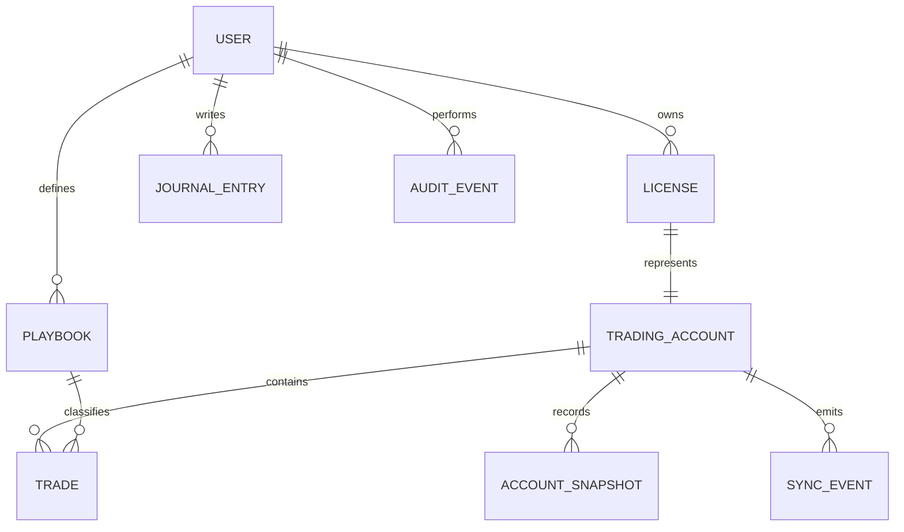
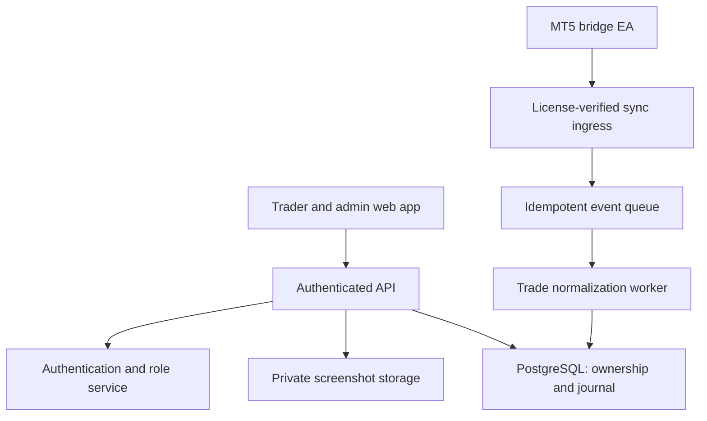

# Structure — Market Structure Journal

A complete, responsive trading journal **UI/UX prototype** with separate trader and administrator workspaces. Inspired by a clean automated-journal dashboard, with a warm gold identity, focused analytics, and connected interaction flows.

**Live private preview:** https://market-structure-journal.m-anasayub80.chatgpt.site

**Source repository:** https://github.com/anasayub80/market-structure-journal

> This is the frontend phase requested for design review. Sample trades, simulated authentication, license activation, and MT5 connections run locally in the browser. There is no live broker connection, backend, email delivery, or production authorization in this version. Do not enter real passwords, trading credentials, or real license secrets.

## Run locally

Node.js 20 or newer. There are no runtime or build dependencies.

```bash
npm run build
npm run dev
```

Open http://localhost:4173. The default view is the user dashboard; use the bottom-left profile menu to switch to the administrator workspace or preview sign-in.

```bash
npm run check
npm test
```

The complete editable source is included in `src/`, not just compiled output. `dist/` is the generated deployable site and is also committed for simple static hosting. Rebuild after changing source. The included development server serves `dist/`, so rebuild and refresh to see edits.

## Design system

- Light neutral canvas, white surfaces, restrained gold accents, semantic sage profits and muted rose losses.
- Manrope headings and DM Sans interface text, with system-font fallbacks. Google Fonts is the only optional external presentation resource; all app logic, charts, and the brand mark ship locally.
- Compact navigation, persistent account/date selectors, consistent table interactions, and generous reading space.
- SVG equity charts, sparklines, session bars, metric visualizations, and original CSS illustrations. No screenshot-based interfaces or embedded external dashboards.
- Light and dark appearance, desktop navigation collapse, mobile drawer navigation, responsive form layouts, and horizontal scrolling for dense tables and calendars.
- Keyboard shortcuts (`Ctrl/Cmd + K`, Escape), modal focus trapping and return, accessible input labels, skip link, keyboard-openable trade rows, reduced-motion support, and visible focus indicators.

## Implemented pages and interactions

### User workspace

| Route | Experience |
| --- | --- |
| `#/user/overview` | Net P&L, win rate, profit factor, equity/drawdown toggle, daily performance, session breakdown, recent trades, daily-review entry |
| `#/user/trades` | Search, instrument/session/outcome filters, account/date scope, pagination, trade detail, setup/mindset/notes review, manual trade creation, CSV export |
| `#/user/calendar` | Monday-first monthly grid, previous/next month, monthly stats, profit/loss day colors, day details, actual daily trades, daily reflections |
| `#/user/analytics` | Overview, session, instrument, setup, weekday, and risk/psychology tabs; real calculations from selected sample trades |
| `#/user/journal` | Searchable reflections, create/edit/delete, daily mood, process rating, date, and review ritual |
| `#/user/playbook` | Setup cards, checklist, timeframe, performance per setup, create/edit, recent setup trades |
| `#/user/accounts` | Multiple licenses/accounts, connection details, activation, rename, disconnect, license status, connection wizard |
| `#/user/reports` | Review report, trade ledger export, metric summary export, daily-result export |
| `#/user/settings` | Profile, preferences, appearance, risk plan, notification preferences, security flow preview, reset demo |
| `#/user/help` | Setup guidance, demo overview, exports, and product FAQ |

### Administrator workspace

| Route | Experience |
| --- | --- |
| `#/admin/overview` | Platform P&L, all users, active licenses, connected accounts, trader performance, recent activity |
| `#/admin/users` | Search users, add user, optionally issue initial license, user details, all-time stats, account list, suspend/restore access |
| `#/admin/licenses` | All user licenses, issue to a selected owner, status changes, expiry edits, owner details |
| `#/admin/accounts` | All trading accounts and their individual equity, ownership, license, and connection state |
| `#/admin/analytics` | Platform statistics with account/date/instrument/session filtering |
| `#/admin/calendar` | Cross-account calendar and per-day trade details |
| `#/admin/connections` | Account/server status, sample heartbeat timestamps, connection inspection, sync-event stream |
| `#/admin/activity` | Local user/license/connection activity log and CSV export |
| `#/admin/settings` | Shared settings interface in the administrator shell |
| `#/admin/help` | Help resources and architecture boundaries |

The role-specific navigation prevents accidental exposure of admin controls in the normal user flow. Browser checks also scope user reads and trade/account edits to the sample user. **These checks are UX demonstrations, not a security boundary.** A production API must enforce permissions independently.

### Authentication and onboarding preview

- `#/login`: credential form, password visibility, user/admin demo entry.
- `#/register`: account creation form and workspace onboarding preview.
- `#/forgot`: password-reset request confirmation; explicitly does not send email.
- `#/onboarding`: workspace creation, license activation, MT5 connection, dashboard entry.

Any syntactically valid demo email and password of at least eight characters can preview sign-in. Passwords are never persisted. Admin demo entry exists only to explore the design and must be removed when real authentication is introduced.

## Core ownership model

**A user can own many licenses. Each license represents exactly one journal account. Each journal account can bind to one MT5 account + broker server.** Multiple chart EAs using the same MT5 account must share that account’s journal identity, rather than creating duplicate journal accounts.

The UI represents `License + TradingAccount` as one combined `accounts` record to keep the prototype simple. The recommended production data model separates them while enforcing a one-to-one relationship:



### Recommended production entities

| Entity | Key fields and constraints |
| --- | --- |
| User | `id`, `email` unique, `display_name`, `role` (`admin` / `user`), `status`, timezone, created timestamp |
| License | `id`, `user_id`, hashed key, masked key prefix, status, expiry, issued/revoked timestamps, last binding timestamp |
| Trading account | `id`, `license_id` unique, `user_id`, nickname, broker, MT5 login, broker server, currency, type, initial balance; unique normalized `(server, login)` |
| Trade | `id`, `account_id`, position/deal IDs, symbol, direction, timestamps, entry/exit, volume, gross profit, commissions, fees, swap, setup, source, initial risk |
| Account snapshot | `account_id`, timestamp, balance, equity, margin, open P&L, deposit/withdrawal adjustment; unique account/timestamp key |
| Journal entry | `id`, `user_id`, optional `account_id`, trading date, title, content, mood, process rating |
| Playbook | `id`, `user_id`, name, description, timeframe, checklist rules, archived flag |
| Trade review | `trade_id`, reviewer owner, notes, mindset, reviewed flag, optional chart attachment references |
| Sync event | `account_id`, idempotency key, cursor, heartbeat, event type, processing state, error code |
| Audit event | Actor, action, target type/ID, timestamp, metadata; append-only on the server |

Production journals/playbooks are user-owned. This demo has one persistent user-owned journal/playbook collection and a single user persona, while admin screens aggregate the sample users' account and trade data.

## Frontend architecture

```text
market-structure-journal/
├── index.html                 Document metadata, app roots, stylesheet/module entry
├── src/
│   ├── app.js                 Router, page compositions, forms, dialogs, actions, persistence
│   ├── data.js                Deterministic seed data, filters, metrics, calendar helpers
│   ├── ui.js                  Escaping, SVG icons/charts, badges, reusable UI renderers
│   └── styles.css             Tokens, layout, components, themes, responsive states
├── public/assets/mark.svg     Original vector brand mark and favicon
├── scripts/
│   ├── build.mjs              Clean and recreate dist/ from complete source
│   └── serve.mjs              Small static local server
├── tests/
│   ├── data.test.mjs          Calculation, scope, reconciliation, calendar tests
│   └── flows.test.mjs         Routing and real form/action handler contract tests
├── dist/                      Built HTML, JS, CSS, and local assets
├── .openai/hosting.json        Site identity and static deployment directory
├── .gitignore
├── package.json
└── README.md
```

### Application state

- Hash routing enables every view to work on ordinary static hosting without rewrite rules.
- Global view state tracks role, route, selected account, date preset, instrument, session, outcome, search, pagination, and tabs.
- A versioned `structure-v1` localStorage document persists sample entities and user edits.
- Transient navigation/filter state is intentionally not persisted. Reload defaults to all accounts and the current demo month.
- `filterTrades` first scopes allowed account IDs, then applies account, period, instrument, session, result, and query filters.
- `metrics` and `groupTrades` derive every statistic from the current ledger. CSV exports use the same selected data as analytics.
- User-provided text is HTML-escaped before rendering. CSV fields are quoted and risky formula prefixes are neutralized.
- User and account changes produce local activity events. Production audit records must be generated by the server.

### Sample dataset and calculation definitions

- The demo date is **October 16, 2026**, with weekday sample trades from August 3 onward. Date presets are deliberately fixed so the design stays populated when viewed later.
- Five sample users, six account licenses, three licenses for the primary user, and seeded histories for four connected/bound accounts.
- Net result = gross trade P&L − fees. Win rate classifies trades after fees.
- Profit factor = net winning total / absolute net losing total; no-loss profitable periods display infinity.
- Equity in period views starts from the sample account's configured opening capital and adds the filtered ledger. It is an illustrative filtered-performance curve, not a broker-reconciled historical snapshot.
- Maximum drawdown = the largest percentage decline from a running equity peak over the selected ledger.
- Average R is the mean stored realized R value; production R must use the original captured stop-risk amount.
- Calendar totals group the same fee-adjusted ledger by trading date, with current account/instrument/session/result scope. Calendar month navigation has its own date scope and intentionally overrides the top-level date preset.
- “Consistency” on the dashboard uses win rate as an illustrative process visualization. It is not a validated proprietary scoring model.
- Sample broker prices and performance are synthetic and do not claim to represent historical market quotes or real returns.

## Connected UX flows

### User: license → account → journal

1. Open **Accounts & licenses** and activate `STRC-DEMO-2026` with an account nickname.
2. The UI creates exactly one account record for that license.
3. Enter the MT5 login, broker, and server. The prototype prevents duplicate account/server binding.
4. Review connector setup instructions and the license/account mapping.
5. Explicitly select **Simulate successful connection**.
6. The account is marked connected locally. Existing sample trade histories remain intact; no fictitious broker trades are imported by this action.
7. Review statistics, open a calendar day, inspect a trade, and save notes or a daily reflection.

A license already bound to an MT5 login cannot be rebound from the standard connection form. Production needs an audited admin rebind workflow and token rotation.

### Administrator: create → license → monitor

1. Open **Users**, add a trader, and optionally issue a first license.
2. Open the user profile to inspect lifetime results and their account list.
3. Issue additional licenses with account type, opening balance, and expiry.
4. Inspect account-level stats, status, heartbeat, and aggregate performance.
5. Suspend a user to suspend their active licenses and disconnect their account states in this demo.
6. Restoring the user restores the user status only; license statuses are separately reviewed and restored.
7. Review the local activity log or export it.

Invitation status is represented in the UI, but no invitation is delivered.

## Recommended production architecture (not implemented)

A practical next implementation uses a Node.js/TypeScript API, PostgreSQL, a background sync worker, and object storage for screenshots. The frontend can migrate to React/Next.js with an API repository adapter while retaining the screen design and ownership rules. These are future architecture choices, not dependencies hidden in this prototype.



### MT5 synchronization contract

1. Admin issues a random high-entropy license; the server stores only a key hash and a masked display prefix.
2. Activation checks ownership, status, expiry, and unique MT5 login/server binding.
3. The bridge exchanges the license for a scoped, short-lived ingestion credential. Browser sessions and ingestion credentials are separate.
4. MT5 sends a heartbeat, account snapshots, and deal batches over TLS via allowed WebRequest origins. The journal never needs the user's trading password.
5. Ingress validates license/account identity, timestamp/nonce or signature, request size, and schema, then queues processing.
6. The worker normalizes symbol suffixes, broker time offsets/DST, commissions, swaps, partial closes, hedging/netting positions, and deposits/withdrawals.
7. Idempotency is enforced on `(account_id, broker_server, deal_ticket)` and batch keys; reconnecting must never duplicate trades.
8. Closed positions derive realized P&L; open-position equity comes from snapshots. Manual entries use separate identifiers to avoid collisions.
9. Server status derives from last heartbeat, not a client toggle. A configurable timeout marks the connection offline.
10. Expiry/revocation blocks new sync, invalidates credentials, and retains historical journal data according to retention rules.

### Suggested API surface

| Endpoint | Authorization | Purpose |
| --- | --- | --- |
| `POST /auth/login`, `/auth/logout`, `/auth/password-reset` | Auth service | Secure session lifecycle |
| `GET /me`, `PATCH /me` | Signed-in owner | Profile and preferences |
| `GET /accounts` | Owner or administrator | Scoped account list |
| `POST /licenses/activate` | Owner | Validate and bind a license |
| `POST /accounts/:id/connect`, `/disconnect` | Owner or administrator | Manage bridge binding/session |
| `GET /trades`, `POST /trades` | Scoped account owner | Trade ledger/manual entries |
| `PATCH /trades/:id/review` | Scoped account owner | Setup, emotion, notes |
| `GET /analytics`, `/calendar`, `/reports` | Scoped owner or administrator | Server-calculated filtered performance |
| `GET/POST/PATCH/DELETE /journal` | Owner | Daily reflections |
| `GET/POST/PATCH /playbooks` | Owner | Setup definitions |
| `POST /sync/handshake`, `/sync/heartbeat`, `/sync/deals` | Account-scoped connector token | MT5 ingestion |
| `GET/POST/PATCH /admin/users` | Administrator | User management and invitations |
| `GET/POST/PATCH /admin/licenses` | Administrator | Issue, suspend, renew, revoke, rebind |
| `GET /admin/stats`, `/admin/connections`, `/admin/audit` | Administrator | Platform observability |

### Production permission rules

| Action | User | Administrator |
| --- | --- | --- |
| Read personal trades, stats, accounts | Own records | All records |
| Add manual trades / review notes | Own records | Explicit audited support workflow |
| Create journals / playbooks | Own records | Own records; support access must be separately authorized |
| Activate license | Assigned licenses only | Issue and assign licenses |
| Change license expiry/status | No | Yes |
| Create/suspend users | No | Yes |
| Read cross-user analytics and audit | No | Yes |
| Ingest MT5 deals | Account-scoped connector only | No browser-level ingestion bypass |

Enforce ownership in every database query/API operation. Do not accept a client-supplied role or owner ID as proof of access. Production also requires session revocation, secure HttpOnly cookies, CSRF protection for mutations, rate limits, invitation verification, account suspension checks, signed storage URLs, secret management, migrations, backups, monitoring, and server-side audit logging.

## Validation and remaining scope

- Twenty automated tests cover financial calculations, fee reconciliation, account scoping, Monday-first/leap-year calendars, every route rendering, trade reviews, journal CRUD, admin user/license creation, duplicate emails, permission guards, the full connection wizard, suspension propagation, manual trades, setup renaming, and risk preferences.
- JavaScript syntax checks and a clean static build run before release.
- The interaction tests use a lightweight DOM contract harness, not a real browser. Browser layout, responsive screenshots, and full assistive-technology checks were not available in this build environment; complete those before production release.
- Backend auth/authorization, real MT5 EA, license service, email, screenshot uploads, open-trade monitoring, deposits/withdrawals reconciliation, billing, cloud persistence, and production security are future work.
- Demo license strings are illustrative public sample values. There are no production secrets in the source.

## Deployment

`npm run build` writes a standalone static site to `dist/`. Publish that directory on a static host. Root-relative asset paths assume deployment at the domain root. Hash routes require no server rewrite configuration.

The included Sites manifest points to `dist/` and preserves the private Site identity. GitHub stores the complete source, tests, documentation, brand asset, scripts, and generated site.
