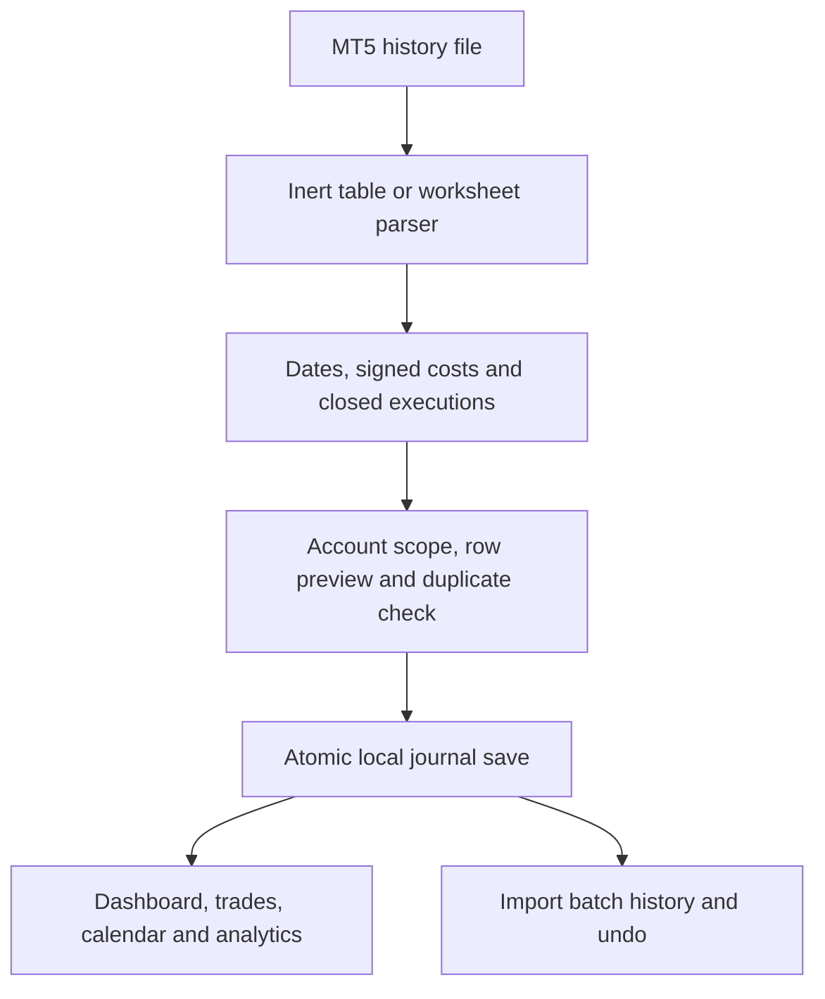
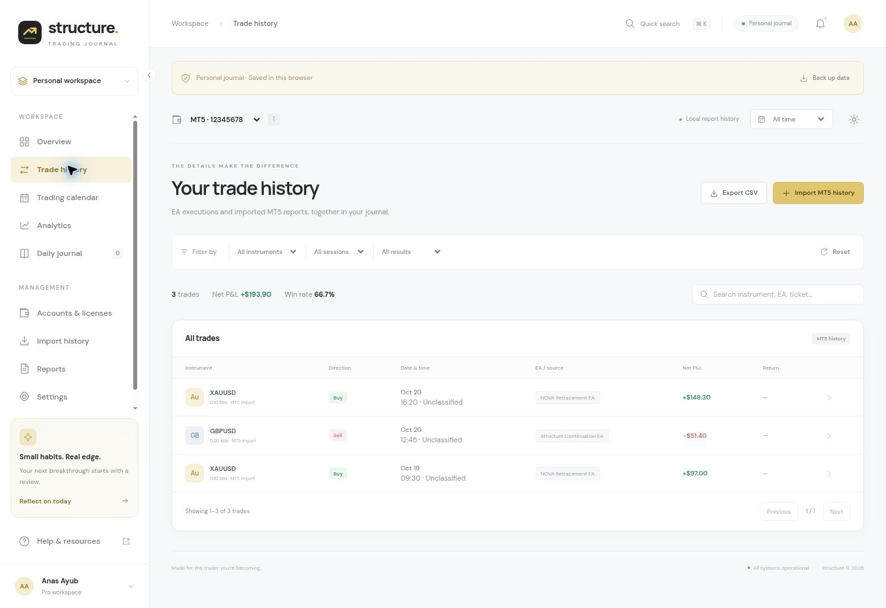

# Structure — MT5 Trading Journal

A working **MT5 file-import journal** with trader and administrator workspaces. Upload an exported trade-history report, review the file, and import completed executions into dashboards, calendars, analytics, and reports. There is no playbook or individual trade-entry form.

**Website:** https://market-structure-journal.m-anasayub80.chatgpt.site

**GitHub:** https://github.com/anasayub80/market-structure-journal

## What works now

- Real local imports from MT5 HTML, MT5 SpreadsheetML/XML (including XML saved with an `.xlsx` extension), zipped XLSX, CSV and TSV.
- Account ownership and selection, create an account from the report, metadata detection, date-order selection, optional broker UTC offset, preview, row issues, totals, duplicate skipping, import history, and batch undo.
- Dashboard, equity/profit curve, trade history and reviews, monthly calendar and day details, session/instrument/EA/weekday/risk analytics, CSV reports, daily monitoring notes, and settings.
- Administrator users list opens the selected user's full workspace and preserves their scope across all pages, imports, and exports.
- Personal mode hides sample executions and accounts. Report data persists across refreshes in this browser. JSON backup downloads preserve a separate readable copy.

**Important boundary:** file importing is functional with real reports. Data is stored locally in the browser, not in a cloud database. Sample authentication, invitation delivery, license verification, and automatic EA/MT5 syncing remain UI previews. The public website serves the application; a visitor's imported report is not uploaded to the host or embedded in source code. Use the same browser/origin to access local history. Clear-site-data operations remove it, so keep the original reports and download backups. JSON backups are exports; a JSON restore UI is not implemented.

## Quick start

Node.js 20+ is sufficient. No install step or package dependencies are required.

```bash
npm run check
npm test
npm run build
npm run dev
```

Open http://localhost:4173. `dev` serves `dist/`; rebuild and refresh after source edits. The complete editable code, fixtures, assets, scripts, tests and compiled site are included.

## How to import MT5 history

1. In desktop MT5 open **Toolbox → History**.
2. Select **All History** or the required date range.
3. Right-click, choose **Positions**, then **Report → HTML**. Export the actual history table, not a screenshot, PDF, or visual analytics summary.
4. In Structure open **Import history** (or **Import MT5 history** from the dashboard/trade history).
5. Choose the file. Standard MT5 `YYYY.MM.DD` dates are the default. Explicit day-first/month-first options handle ambiguous spreadsheet dates.
6. Select an existing journal account or create a file-import account. Verify account number, broker server and USD currency. Starting balance is optional; use the balance immediately before the exported period, not the report's closing balance.
7. Review counts, P&L, preview rows and validation notes. Confirm **Import trades**.
8. Open trades, dashboard, analytics or calendar. Repeat files skip existing tickets. Undo removes only the new trades added by a specific batch.

The MT5 export workflow and report sections are described in the [official MetaTrader 5 history-report help](https://www.metatrader5.com/en/terminal/help/trading_advanced/history_report).

A small [example CSV](public/assets/mt5-import-example.csv) ships with the app. It contains synthetic data and demonstrates the supported headers, with a USD net result of **193.90** across three trades.

### Supported files and boundaries

| Format / report | Behavior |
| --- | --- |
| MT5 HTML completed positions | Repeated `Time` / `Price` headers become opening and closing values. Summary, balance, credit, orders, and open-position rows are excluded. |
| MT5 XML / SpreadsheetML | Reads row/cell data and sparse column indexes. Detected by contents, even when the filename ends in `.xlsx`. |
| Native XLSX | Reads ZIP worksheets, inline/shared strings, and stored/deflated XML using native browser APIs. Numeric Excel date serials are supported in timestamp columns. |
| CSV / TSV | Comma, semicolon or tab delimiters, BOM, quoted fields and multiline comments. Header aliases cover standard MT5 names. |
| Deals with position IDs | Pairs opens/closes by exact position identity; partial closes proportionally allocate opening commissions. Each closing deal becomes a realized execution. |
| Deals without position IDs / missing opening records | Rejected or listed as row issues. Re-export completed Positions or include all opening history. The importer does not guess which hedged position a deal closed. |
| Reversal (`in/out`) deal records | Listed as unsupported. Export completed Positions instead. |
| PDF, images, binary `.xls`, encrypted or oversized workbooks | Not supported; actionable errors direct the user to HTML/history exports. |
| Non-USD or mixed-currency reports | Blocked to avoid labeling another currency as dollars. Currency conversion is not implemented. Files missing currency information display a USD warning. |

Limits: 10 MB input, 50,000 rows, 32 MB decompressed workbook XML, 512 ZIP entries, and 1,001 worksheet columns. English column names are supported. Very large imports can exceed the browser's localStorage quota; the save is atomic and a failed save leaves the previous journal intact.

## Import architecture

`src/importer.js` implements parsing and pure data operations. `src/imports-ui.js` owns the file-import screen and invokes those operations through an injected app interface. Existing rendering/calculation helpers serve both sample and imported data.



- Files are read through a file chooser or drag/drop. HTML is parsed as text; scripts, styles and external assets are never executed or loaded.
- Account number/currency metadata and normalized trade rows are extracted. Gross P&L, signed costs and swap credits retain their financial meaning.
- Duplicate identity is `(journal account, broker record kind, ticket)`. Duplicate rows within the file and already imported rows are skipped. Re-importing a corrected ticket does not silently overwrite a reviewed execution; undo the prior batch and re-import if needed.
- Importing overlapping position aggregates and deal records for the same position is blocked, preventing double counting across report views.
- A new report cannot be attached to a different owner's account, a seeded sample account, a mismatched MT5 login, or a mismatched currency.
- A new file-import account has `mode: import`, `connection: File import`, and no live license entitlement. File imports do not consume or pretend to verify a trading license. Existing real journal/license accounts can receive matching history reports.
- The user may import all completed report rows, or restrict to rows with a reported non-zero magic number. Missing EA identity is labeled **Not provided by report**. Files without magic metadata cannot prove EA origin; it is never inferred from profit, symbol or comments.
- Notes and reviewed flags annotate executions; entry/exit prices, size, P&L, costs, advisor identity and magic number are read-only.
- A cloned database is committed to localStorage before the live state is replaced. Storage failures do not announce success or partially mutate the ledger.
- Batch records retain owner, target account, filename, timestamp, counts, period, net result and warnings. Undo deletes only records with that batch ID; pre-existing and skipped duplicate trades remain.
- Original files remain on the user's device. The application retains normalized history and provenance, not raw report HTML.
- JSON backup exports include only the current user's accounts, trades, notes, settings and imports; the admin platform context can export all local users' data. There is no production security boundary in this static prototype.

## Financial and date calculations

- Native MT5 row result = reported gross profit + signed commission + signed fee + signed swap. Internally `fees` stores the opposite signed sum, allowing credits as negative costs. App-exported `Fees` columns represent a direct cost amount.
- Deposits, withdrawals and credits do not count as trades or trading P&L. They are not silently converted into profit.
- Missing commission/fee/swap columns generate a warning: totals use the reported profit and cannot reconstruct unavailable charges.
- Each completed position row is one trade; position-linked deal imports count each partial closing execution. The preview states which layout was detected.
- Original risk is usually absent from reports. R remains `null`; averages use only known R values, and unavailable R displays as a dash. The importer does not infer original risk from a stop that may have been modified.
- Without a known positive starting balance, the curve represents cumulative net P&L. Account return and percentage drawdown display as unavailable. With starting capital, the curve is starting capital plus the **selected** realized ledger; it is a closed-trade performance view, not live broker equity or a cash-flow-reconciled statement.
- Calendar dates preserve broker-reported closing dates. Open/close timestamps remain in broker clock time. Holding time uses their difference.
- Session labels remain **Unclassified** until the user supplies a broker UTC offset. The simplified UTC buckets are Asia 00:00–07:00, London 07:00–12:00, New York 12:00–21:00, otherwise Unclassified. These are fixed journal buckets, not DST-aware exchange-session calendars.
- Date presets are calculated from the current user timezone for personal data; sample mode anchors at October 16, 2026. New imports select All time and move the calendar to the newest imported close date. Reload restores the primary user's latest import account and All time.
- Profit factor, expectancy, net wins/losses, daily totals and exports derive from the same filtered ledger. “Consistency” remains an illustrative win-rate visualization, not a proprietary process score.

## Pages and roles

| Route | Purpose |
| --- | --- |
| `#/user/overview` | Net performance, win rate, profit factor, balance/P&L curve, daily and session results, recent trades |
| `#/user/trades` | Account/date/instrument/session/result filters, search, pagination, execution detail, notes, CSV export, import entry |
| `#/user/calendar` | Month navigation, daily P&L, day trades and daily notes |
| `#/user/analytics` | Overview, sessions, instruments, advisors, weekdays and risk review |
| `#/user/imports` | Real file import, preview, account choice, validation, history, undo, JSON backup |
| `#/user/journal` | Daily monitoring reflections, date, mood, rating, create/edit/delete |
| `#/user/accounts` | Local import accounts and license/MT5 preview accounts; matching history import and account management |
| `#/user/reports` | Selected-period report, trade ledger, metrics and daily CSV exports |
| `#/user/settings` | Profile/timezone, preferences, risk plan, appearance, notifications and security previews |
| `#/user/help` | FAQs, export/import help and connection guidance |
| `#/admin/overview` | Aggregate stats, trader results, license and connection summaries |
| `#/admin/users` | Search/add users; click a row to enter the full user workspace |
| `#/admin/users/:userId/:page` | Same user pages, restricted to the selected owner's records, with user switcher and Back to admin |
| `#/admin/imports` | Import for a selected local user, inspect platform import history and export local platform backup |
| `#/admin/accounts`, `#/admin/licenses` | Account ownership, issuing/editing preview licenses and expiry/status |
| `#/admin/calendar`, `#/admin/analytics` | Platform scoped calendar and performance |
| `#/admin/connections`, `#/admin/activity` | Preview sync health and local activity events |
| `#/admin/settings`, `#/admin/help` | Settings and resources |

Login, registration, password reset and onboarding routes remain prototype flows (`#/login`, `#/register`, `#/forgot`, `#/onboarding`). Never enter real credentials. User/admin role switching is a design demo, not authentication. Admin access must be enforced server-side before this becomes a multiuser production service.

## Ownership and future production architecture

**A user owns multiple accounts. A live connection uses one license per MT5 login/server; one account can run multiple EAs distinguished by imported magic/EA identity. File-import accounts support offline history without a live entitlement.**

Current local entities:

| Entity | Important fields |
| --- | --- |
| User | ID, display name, email, status, role context |
| Account | Owner ID, login/server, nickname, USD currency, opening balance/known flag, source mode, demo flag, license/connection preview state |
| Trade | Account, broker key/ticket/position ID, position/deal layout, open/close timestamps/prices, volume, gross P&L, signed total costs, EA/magic, optional R, import batch, review notes |
| Import batch | Owner/account, filename, creation time, imported/duplicate/skipped/excluded counts, period, net result, warnings |
| Journal entry | Owner, date, title, reflection, mood, process rating, demo flag |
| Settings | Owner profile/timezone, risk reminders, notification preferences, appearance |
| Activity | Actor/owner context, event description, timestamp, type |

For production, use an authenticated TypeScript API, PostgreSQL, account/license records, append-only audit events, an ingestion queue/worker, account snapshots and optional object storage. File imports should use the same normalization/deduplication service as the MT5 connector, with upload limits and atomic database transactions. API queries must derive owner/role from the authenticated session, not a route or browser-supplied ID. Server audit records must retain both admin actor and target owner.

Suggested production operations: session login/logout/reset; owner profile/preferences; scoped accounts/trades/analytics/calendar/reports; execution review notes; import upload/preview/commit/undo; daily journals; admin user/license management; account-scoped connector handshake/heartbeat/deal ingestion. The import account type is separate from a verified live connection. A new history file must never grant trading access.

Automatic MT5 sync still needs a read-only bridge EA, license activation and binding, scoped short-lived ingestion tokens, TLS, timestamp/replay checks, position/deal normalization, idempotency, snapshots, heartbeat/offline status, revocation, and server enforcement. No broker trading password is required by this journal design. The existing connection wizard explicitly simulates its handshake.

## Source layout

```text
src/app.js                Routing, user/admin pages, shared actions, journal state
src/data.js               Samples, schema migration, filters, metrics, calendars
src/ui.js                 Safe renderers, SVG icons, curves and chart primitives
src/importer.js           HTML/XML/XLSX/CSV readers, normalization, plan/commit/undo
src/imports-ui.js          File workflow, preview, scoped account selection, backups
src/styles.css            Existing gold/light identity, dark theme, responsive layouts
public/assets/            Original mark and downloadable example CSV
scripts/build.mjs         Copies complete source/assets to dist
scripts/serve.mjs         Small local static server
tests/                    Calculation, role flow, parser and import workflow tests
.openai/hosting.json       Existing Site ID and static directory
README.md                 Product behavior, architecture and supported boundaries
```

No dependencies or CDN parser are used. XLSX decompression uses `DecompressionStream('deflate-raw')`; browsers without that support receive guidance to export HTML instead. Optional Google Fonts have system-font fallbacks.

## Verification

- 53 automated tests cover financial reconciliation, calendar/filter scope, all role routes, user drill-through, editing isolation, HTML/XML/CSV/native-XLSX parsing, UTF-16, costs/swap credits, duplicate/batch handling, exact-position partial closes, unsupported/malformed files, mismatched accounts/currencies, source filtering, atomic quota failure and reload persistence.
- Browser QA exercised choosing a report, file preview, new account creation, a successful three-trade import, ledger totals, calendar day totals, persistence after reload and a repeated-file preview showing zero new trades / three duplicates.
- Responsive layouts and keyboard controls are implemented. Dedicated mobile-device and assistive-technology certification are not claimed.
- The remaining backend/auth/live-bridge scope is described above. This release completes the **file-based local journal workflow**, not a hosted multiuser financial-data backend.

## Deployment and source preservation

`npm run build` creates standalone `dist/` for domain-root static hosting. Hash routes need no server rewrites. The Sites manifest retains the existing project ID. Publish through the Sites workflow without changing the current audience. GitHub contains complete source, generated site, tests, fixtures, scripts, assets and this README.

### Import verification screenshot

Synthetic report data shown after import and reload:


