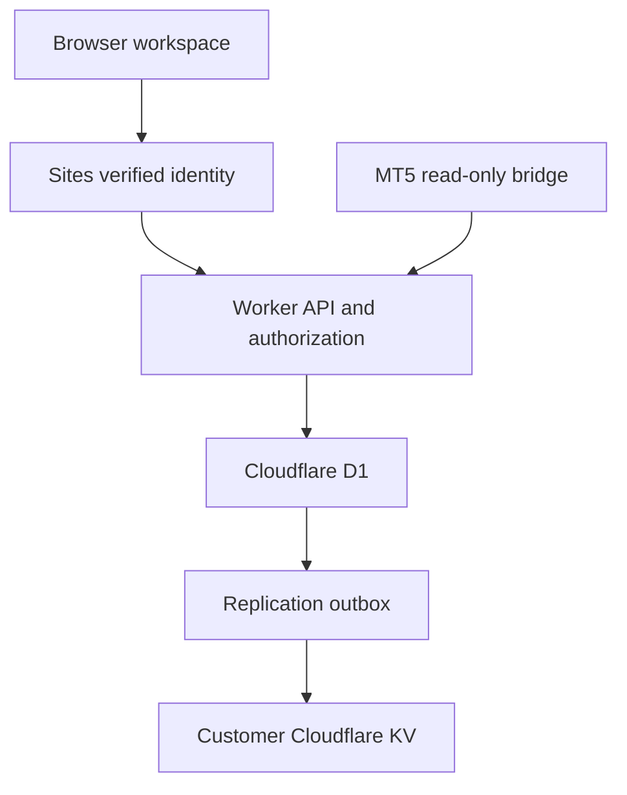

# Structure — Cloud Trading Journal

Structure journals **EA execution history**, with real server persistence, verified user/admin access, MT5 report imports, account analytics, and a trading calendar. It contains no playbook and no individual trade-entry form.

- Website: https://market-structure-journal.m-anasayub80.chatgpt.site
- Repository: https://github.com/anasayub80/market-structure-journal
- Runtime: Cloudflare Workers, Cloudflare D1, optional customer-owned Workers KV
- UI: accessible vanilla JavaScript modules, responsive CSS, SVG charts; no frontend framework

## Start using it

1. Open the website. The configured administrator can sign in with email and password; other traders can choose **Continue with ChatGPT**. Passwords are checked against a salted server-only hash and are never stored in plaintext.
2. Server-only configuration provisions the owner administrator and optional goal account idempotently. All other new identities receive the user role. Changing a URL cannot grant administrator access.
3. Administrators can add traders by their exact sign-in email, issue account licenses, suspend/restore access, and click a trader to open their complete panel.
4. In **Import history**, upload an MT5 export, review the preview, select/create its account, and confirm. The server parses the original file again and saves the executions.
5. For customer-owned KV storage, open **Admin → Platform settings → Cloudflare** and complete the connection described below.

No sample users or executions are shipped or seeded into production. Optional server-only configuration provisions the real owner and one empty account. Synthetic datasets live exclusively under `tests/fixtures/`, outside the built website. The local development database is separate; an ignored `.local/preview-env.json` can supply a private owner configuration for QA.

## Cloudflare account connection

The frontend and API are hosted by Sites on Cloudflare Workers. Sites provisions the transactional **D1 database**. Your own Cloudflare account is a separate connection: it is not silently connected by deploying this project.

In your Cloudflare dashboard:

1. Create a Workers KV namespace dedicated to Structure.
2. Copy its namespace ID and your account ID.
3. Create an API token scoped to **Workers KV Storage → Edit** for that account. Use an API token rather than your global API key.
4. Sign in to Structure as administrator and enter those values in **Platform settings → Cloudflare**.

The server verifies write access with a non-sensitive test key that expires after 60 seconds. It encrypts the credential with AES-256-GCM before storing it in D1. The API never returns the token. Do not place tokens in chat, source control, frontend environment variables, or browser storage.

After connection, versioned journal snapshots sync into KV. Settings shows the connection, last successful sync, pending changes, and a retry control. Disconnecting removes the encrypted credential and stops future writes; it retains journal records and existing snapshots. Revoke the token separately in Cloudflare if appropriate.

**Current connection status is a runtime setting, not a claim made by this README.** A namespace is connected only after the administrator completes the form and the server's write test succeeds.

### Why D1 and KV are both used

KV is eventually consistent. Immediate suspension, account ownership, duplicate prevention, and atomic import visibility require transactional coordination. D1 is the authoritative record store for these operations. KV stores customer-owned, immutable journal snapshot versions. A KV outage does not undo accepted journal writes; an outbox tracks pending replication.

This is deliberately not a KV-only authentication database. Official references:

- https://developers.cloudflare.com/kv/concepts/how-kv-works/
- https://developers.cloudflare.com/api/resources/kv/subresources/namespaces/subresources/values/methods/update/
- https://developers.cloudflare.com/d1/

A native `JOURNAL_KV` Worker binding is supported by the storage adapter for alternate hosting arrangements. The Sites manifest currently exposes the managed D1 binding; the customer KV connection uses the server-side Cloudflare REST API.

## Architecture



| Layer | Files | Responsibility |
| --- | --- | --- |
| Application | `src/app.js` | Routing, user/admin panels, tables, reviews, calendar, analytics, forms |
| API client | `src/cloud.js` | Same-origin authenticated requests; server-confirmed state updates |
| Report UI | `src/imports-ui.js` | Local preview, target account, upload confirmation, batch history/undo |
| Report parser | `src/importer.js` | HTML/XML/XLSX/CSV parsing, timestamps, signed costs, duplicate planning |
| Analytics | `src/data.js`, `src/ui.js` | Metrics, scoped filters, calendars, escaped reusable UI, SVG charts |
| Worker | `server/index.js` | Static asset delivery, API routing, CSP/security headers |
| Identity/store | `server/store.js` | Verified identities, server roles, owner checks, D1 hydration |
| Password sessions | `server/password-auth.js` | Owner password validation, rate limits, hashed revocable sessions |
| Owner setup | `server/provision.js` | Idempotent runtime-configured administrator and empty goal account |
| Goal tracking | `src/goals.js` | Closed-balance progress, weekly count, A+ annotations, risk milestones |
| API actions | `server/api.js` | Validated mutations, admin operations, credential lifecycle, EA ingestion |
| Import service | `server/imports.js` | Server-side parsing, per-account staging, atomic publication, undo |
| KV adapter | `server/cloudflare.js` | Encrypted account connection, immutable snapshots, replication/retry |
| Security helpers | `server/security.js` | Input validation, origin checks, bounded request bodies, encryption/hashing |
| Schema | `drizzle/*.sql` | Immutable schema and appended session migration |
| Bridge source | `public/assets/StructureBridge.mq5` | Read-only MT5 position-history sender |

### Record model

| Record | Relationship and behavior |
| --- | --- |
| User | Verified identity ID; unique email; role `user`/`admin`; access status; profile/preferences |
| Account | Belongs to one user; can be a file-import account or an EA account |
| License | One administrator-issued license maps to one EA account; expiry and revocation enforced server-side |
| MT5 binding | A non-empty login/server pair can belong to only one account platform-wide |
| Connector credential | Separate from license; 256 random bits; only SHA-256 digest stored; shown once; revocable |
| Import batch | Account/owner; pending, committed, or undone; filename/totals/period/warnings |
| Trade | Account, owner, batch, broker key, immutable execution values, mutable review annotations |
| Reflection | User-owned daily review; independent of broker execution data |
| Audit event | Actor, target owner, server timestamp, event type |
| KV outbox | Pending/synced replication records; failures do not discard the accepted journal write |

Production contains only real configured or user-created records. `src/data.js` contains formatting and analytics helpers; all legacy sample generators/migration fixtures were moved into `tests/fixtures/legacy-data.mjs`. They are never included in the build. Opening capital defaults to zero unless supplied by the account. Empty curves preserve the account's actual opening balance.

### Authentication and authorization

Sites dispatch owns `/signin-with-chatgpt`, `/signout-with-chatgpt`, and `/callback`. Authentication uses top-level navigation with `return_to`. Its trusted identity headers are consumed by the Worker; browser-supplied role fields are ignored. Owner password sign-in is an additional explicitly requested authentication path and preserves the existing ChatGPT integration.

- Anonymous workspace requests receive 401.
- The owner password hash is a salted PBKDF2-SHA256 digest configured as `ADMIN_PASSWORD_HASH`, not a source-code constant. Login is limited by both client IP and account email.
- Password sessions last 12 hours, use random 256-bit tokens, and set `__Host-structure_session` with Secure, HttpOnly, SameSite=Strict, and Path=/. Only token digests are stored in D1. Logout, expiry, suspension, and credential rotation revoke access.
- `/api/session` and login may idempotently provision the configured owner/account from private runtime settings. Anonymous callers cannot choose its identity or account configuration.
- Ordinary users receive only their own records, and every mutation independently checks ownership.
- Admins receive platform data and can open any user's full panel. The visible banner retains administrator context; it does not change the signed-in identity.
- An administrator-added email is linked to its existing invited user record at the first matching verified sign-in.
- `ADMIN_EMAIL` is a server-only bootstrap setting. There is no public first-user-becomes-admin route or frontend role switch.
- Suspended users are rejected on subsequent requests and on connector ingestion. Restoring access retains history and existing license settings.
- POST requests from browsers require the same origin and JSON or multipart content. API responses use `no-store`.
- The Worker must stay behind Sites' authenticated dispatcher. `AUTH_PROVIDER=sites` is required. Do not deploy this entrypoint as a public standalone Worker that trusts arbitrary incoming identity headers; alternate hosting needs its own verified identity adapter.

### Import lifecycle and concurrency

The browser parses the file for preview. Confirmation uploads the original file and target metadata. The Worker parses that file independently, verifies owner/account/currency/binding, and computes duplicates against committed records.

A partial unique index allows only one pending import per account. New trades remain invisible until their batch is committed. Trades are inserted in bounded chunks, then the batch becomes committed. Failed staging removes its inserted rows; an interrupted pending import can be reclaimed after ten minutes on retry. A unique `(account_id, broker_key)` constraint provides a second duplicate barrier. Undo hides the batch and removes only executions created by it. Existing account data and skipped duplicates remain intact.

A successful UI save uses the server response. The browser never submits a replacement platform database.

### KV snapshot layout

`structure:v2:user:<owner-id>:<revision>:trades:<chunk>` contains chunks of 250 executions. A `:manifest` key records the owner, version, timestamp, count, chunk keys, and remaining workspace data. A manifest is published after all chunks succeed. Revision keys are immutable and are not used as permission records.

The outbox retries on later writes or the administrator's retry action, up to five owners per pass. This version does not run a separate scheduled replication daemon. For large journals, use repeated retries to finish backlogs. KV retains historical versions; configure your desired retention/cleanup policy before sustained large-volume operation. JSON backup download is available; automatic disaster-recovery restore from KV is not implemented.

## MT5 report import

Supported: native closed-position HTML, SpreadsheetML XML (including XML saved with an `.xlsx` suffix), zipped XLSX, CSV/TSV. Encoding is detected, including UTF-16 MT5 reports. HTML is parsed as text and never executed.

Export from desktop MT5: **Toolbox → History → All History/custom period → Positions → Report → HTML**. Upload the resulting file in Import history.

- Maximum uploaded file: 10 MB. Maximum committed batch: 5,000 executions; export smaller periods for larger histories.
- ZIP expansion is bounded; PDF, binary XLS, screenshots, and chart-only reports are rejected.
- USD accounts only. Mixed currencies are rejected rather than silently converted.
- Signed commission, fees, and swap are included in net P&L. Positive swap credits are preserved.
- Calendar dates follow broker closing dates. Set the broker UTC offset for session labels; unknown offsets remain unclassified.
- Missing original risk leaves R metrics unavailable. Unknown opening capital leaves percentage return/drawdown unavailable.
- Non-zero magic filtering is optional for file reports because some MT5 exports omit the Magic column. Advisor identity is not invented.
- Deal-only reports require sufficient position-linked opening records. Unsupported reversals or incomplete pairing produce errors. Do not mix overlapping position and deal layouts in one account.
- Prices, volume, times, and broker P&L are immutable after import. Notes/review flags are editable.

Imports saved by older versions only in a browser are **not automatically uploaded**. The old `structure-v1` key is not erased. Reimport the original MT5 reports into the cloud workspace; do not assume earlier device-local history has migrated.

## Automatic EA history bridge

1. Have the administrator issue a license for the user.
2. Bind it to the MT5 login/server through Accounts & licenses.
3. Generate a connector credential and save it when shown. Generating another immediately invalidates the previous credential.
4. Download `StructureBridge.mq5` from the connection dialog and compile it in MetaEditor.
5. In MT5, allow WebRequest for the journal's HTTPS origin. Attach the bridge to one chart, enter the full `/api/ea/ingest` endpoint and credential, and keep the terminal/VPS running.

The endpoint checks credential digest, owner status, license status/expiry, MT5 binding, USD currency, payload limits, and non-zero magic. Real heartbeats establish Connected status. A last heartbeat over three minutes old appears Offline. Disconnect revokes the connector credential while retaining history.

The bridge sends up to 200 recent closed positions by default (maximum 500), over a configurable 90-day window. Older history should be imported through reports. It aggregates entry/exit fills, commissions, fees, and swaps for fully closed positions; skips still-open positions, netting reversals, mixed-magic positions, and incomplete histories rather than inventing values. It contains no trading operations. Replayed position IDs are deduplicated.

**Verification limit:** the endpoint is integration-tested with synthetic payloads. The `.mq5` source has not been compiled or run inside an actual MetaTrader terminal in this environment. Compile and test on your demo terminal before using it on a VPS. Terminal strategy testers do not support live WebRequest behavior.

## Development

Node.js 24+ is required for the local SQLite adapter. Production uses Worker Web APIs and D1.

```bash
npm ci
npm run check
npm test
npm run build
npm run dev
```

Local preview runs on port 4173 and uses `.local/journal.sqlite`. It injects a synthetic development owner **only inside the local server**, never in the deployed Worker. `.local/`, environment files, generated asset intermediates, and credentials are ignored by Git.

Build embeds the UI assets and API modules into `dist/server/index.js`, with a matching `dist/.openai/hosting.json`. Source `.openai/hosting.json` retains the existing Site ID and declares `d1: "DB"`; it is no longer a static-only site. The source workflow packages the immutable SQL migration. Sites provisions the binding and applies migrations before publication. Do not rewrite an applied migration; append future migrations.

### Runtime configuration

| Key | Purpose | Secret |
| --- | --- | --- |
| `AUTH_PROVIDER` | `sites`; deployment must remain behind the trusted Sites dispatcher | No |
| `ADMIN_EMAIL` | Verified owner email eligible for admin bootstrap | Server-only |
| `ADMIN_PASSWORD_HASH` | JSON salted hash from `scripts/hash-password.mjs`; never a plaintext password | Yes |
| `OWNER_WORKSPACE_CONFIG` | Private JSON owner/account goal configuration; provisioned once by stable account key | Yes |
| `INTEGRATION_SECRET` | At least 32 random characters; AES-GCM key derivation for Cloudflare credentials | Yes |
| `DB` | Provisioned Cloudflare D1 binding | Binding |
| `JOURNAL_KV` | Optional native KV binding for an alternate deployment adapter | Binding |

The hosted runtime settings are configured outside the repository. Preserve `INTEGRATION_SECRET` across deploys; replacing it without re-entering the customer KV token makes the old encrypted credential unreadable.

## API

| Route | Authentication | Purpose |
| --- | --- | --- |
| `POST /api/auth/login` | Configured owner password + same origin | Start a secure owner session |
| `POST /api/auth/logout` | Same origin | Revoke the cookie session |
| `GET /api/session` | Verified user | Current identity/role and admin integration status |
| `GET /api/workspace` | Verified user | Owned records, or platform records for admin |
| `POST /api/action` | Verified user + owner/admin checks | Typed profile, review, reflection, account, user, license, undo mutations |
| `POST /api/imports` | Verified user + owner checks | Multipart original file + JSON options, server parse/commit |
| `GET /api/cloudflare` | Admin | Redacted connection and replication status |
| `POST /api/cloudflare/connect` | Admin | Verify/encrypt scoped KV credentials |
| `POST /api/cloudflare/sync` | Admin | Retry pending snapshot replication |
| `POST /api/cloudflare/disconnect` | Admin | Stop snapshots, retain existing data |
| `POST /api/ea/ingest` | Account bearer credential | Read-only completed EA positions/heartbeat |

## Validation and current boundaries

Automated tests cover authentication, owner/admin checks, forged roles, suspension, imports, duplicate replay, immutable execution values, cross-origin rejection, account binding, connector rotation/revocation, encrypted KV configuration, failed replication, parser formats, costs, timestamps, calendars, and authenticated UI routes. Backend tests use real SQLite with the production SQL and API handlers.

Browser QA covers creating a trader, entering their full panel, confirming a real file upload, cloud save/reload, and integration settings. All test records are synthetic and remain in the separate local preview database.

Email notification delivery is not configured; the UI explicitly states this. Other traders use ChatGPT authentication and its recovery flow. Changing the configured owner password requires updating its salted hash through secure runtime configuration; no public password-reset endpoint is provided. The bridge is read-only. This is not a broker execution terminal, a multi-currency valuation engine, or a full account-equity feed. Large teams may require server pagination and asynchronous import/replication jobs beyond this initial architecture.


## Private owner setup and compounding rules

`ADMIN_EMAIL`, `ADMIN_PASSWORD_HASH`, and `OWNER_WORKSPACE_CONFIG` are set through secret runtime settings. Do not commit actual credentials, personal account plans, or trade records. The password helper reads from hidden stdin and emits a salted hash; capture its output directly into the runtime secret, not a public terminal transcript. Existing applied migrations are unchanged; `0001_password_sessions.sql` adds session and login-limit tables.

The owner configuration names the owner, stable `accountKey`, account nickname, initial/target balances, base risk, net-profit step, and timezone. The account is created once with known opening capital, an administrator-owned license, no broker binding, and **zero executions**. Later requests/deployments do not duplicate it, erase history, or reset its balance.

For accounts with a goal:

- Progress uses opening balance plus all actual closed net P&L, including fees.
- Risk stage is `max(0, floor((closedBalance - initialBalance) / stepProfit))`.
- Planned risk is `baseRisk × 2^stage`; drawdowns below a milestone reduce the stage. The target ends the next-trade prompt.
- Weekly counts use Monday-first broker entry dates, scoped to the account.
- A+ quality is an explicit review annotation, never inferred from profit or fabricated by the journal.
- The milestone table exposes percentages and labels planned risks that exceed capital. The system tracks the requested rule without placing orders or enforcing it at the broker.

`src/goals.js` renders the account plan on the owner's overview, the admin overview, and Accounts. Execution review permits a setup grade while broker execution values remain immutable.
